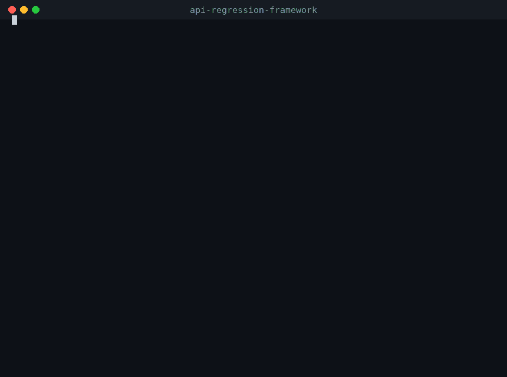

# API Regression Framework

A data-driven framework for regression testing REST APIs. Test scenarios are written in YAML, run in order, and **assert** on status codes and response fields, so every run gives a clear pass or fail.

It ships with a small mock subscriber-lifecycle API, so you can clone the repo and run everything locally with no external services.


**Requires Python 3.10–3.13.** Some dependencies don't yet publish prebuilt packages for newer versions.

## Demo



## Why this exists

Telecom and account-provisioning systems need the same business flows tested over and over: create an account, suspend it, restore it, change features, close it. Writing a new script for each flow leads to thousands of lines of copy-pasted requests. This framework turns each flow into a short YAML file and keeps the request logic in one place.

## Features

- **YAML scenarios** with ordered steps, expected results and saved variables (`${subscriber_id}`)
- **Real assertions** on status codes, JSON field values and list contents
- **Cleanup first and last**: every scenario deactivates its test accounts before the first test step and again after the last, even when a step fails, so runs can be repeated back to back
- **Config from environment variables** (`.env`), so no URLs or secrets live in code
- **Resilient HTTP client** with timeouts and retries on transient errors
- **pytest integration**: each scenario becomes a test case, with JUnit XML output for CI
- **Mock API server** (FastAPI) for local runs and CI
- **GitHub Actions** workflow testing on Python 3.10 and 3.12

## Project layout

```
api-regression-framework/
├── mock_server/app.py        # In-memory mock subscriber API (FastAPI)
├── regression/
│   ├── client.py             # HTTP client: auth, timeouts, retries
│   └── runner.py             # Scenario loader, runner and CLI
├── scenarios/                # YAML test scenarios
│   ├── subscriber_lifecycle.yaml
│   └── negative_cases.yaml
├── tests/                    # pytest suite (starts the mock server automatically)
├── .env.example
└── requirements.txt
```

## Quick start

```bash
python -m venv .venv
source .venv/bin/activate        # Windows: .venv\Scripts\activate
python -m pip install -r requirements.txt

# Run the full test suite (starts the mock API automatically)
python -m pytest
```

### Run scenarios from the command line

```bash
cp .env.example .env             # Windows: copy .env.example .env

# Terminal 1: start the mock API
python -m uvicorn mock_server.app:app --port 8000

# Terminal 2: run all scenarios
python -m regression.runner scenarios/ -v
```

> **Windows tip:** commands are run as `python -m ...` so they work even when Windows Application Control blocks the `.exe` launchers that pip creates.

Example output:

```
[PASS] Subscriber full lifecycle
   ok  Clean up (before): Deactivate 5550100001 (status 200, 2 ms)
   ok  Clean up (before): Deactivate 5550100002 (status 200, 1 ms)
   ok  Create subscriber (status 201, 2 ms)
   ok  Suspend service (status 200, 2 ms)
   ...
   ok  Closed account rejects changes (status 409, 2 ms)
   ok  Clean up (after): Deactivate 5550100001 (status 200, 1 ms)
   ok  Clean up (after): Deactivate 5550100002 (status 200, 1 ms)

2/2 scenarios passed
```

The command exits with code `1` if any scenario fails, so it works as a CI gate.

## Writing a scenario

```yaml
name: Suspend and restore
variables:
  phone: "5550100050"

# Runs before the first step and after the last one.
cleanup:
  - name: Deactivate ${phone}
    method: POST
    path: /api/v1/subscribers/deactivate
    body: {phone_number: "${phone}"}
    expect:
      status: 200

steps:
  - name: Create subscriber
    method: POST
    path: /api/v1/subscribers
    body: {first_name: Test, last_name: User, phone_number: "${phone}", plan: prepaid}
    expect:
      status: 201
      json: {status: active}
    save:
      subscriber_id: id          # save response field "id" for later steps

  - name: Suspend
    method: PATCH
    path: /api/v1/subscribers/${subscriber_id}/status
    body: {status: suspended}
    expect:
      status: 200
      json: {status: suspended}
```

| Key | Purpose |
|-----|---------|
| `expect.status` | Expected HTTP status code |
| `expect.json` | Fields that must equal a value (dotted paths like `account.plan` or `features.0`) |
| `expect.contains` | List or string fields that must contain a value |
| `save` | Store response fields as variables for later steps |
| `stop_on_failure` | Stop the scenario at the first failed step (default `true`) |
| `cleanup` | Steps that run first and last, to put test data into a known inactive state |

### Clean data first and last

A regression run is only trustworthy if it starts from a known state. An account left open by an earlier run, or by a run that failed halfway, makes the next run fail for reasons that have nothing to do with the system under test.

So every scenario declares `cleanup` steps, and the runner executes them twice:

1. **First**, before any test step, to deactivate whatever is open on the scenario's test numbers. If this fails, the test steps are skipped, because results against unknown data mean nothing.
2. **Last**, after the test steps, to leave the data inactive for the next run. This always runs, even when a test step fails.

Cleanup steps are ordinary steps, so they should call something that is safe to repeat. The mock API's `POST /api/v1/subscribers/deactivate` closes any open account on a phone number and returns 200 whether or not one existed.

The test suite enforces this: every file under `scenarios/` must declare `cleanup`, and all scenarios must pass twice in a row against the same server with no reset in between.

## Pointing at a real API

Set `API_BASE_URL`, `API_USERNAME` and `API_PASSWORD` in `.env` (or as CI secrets) and write scenarios that match your API's endpoints. Use test environments and test data only.

## License

[MIT](LICENSE)
